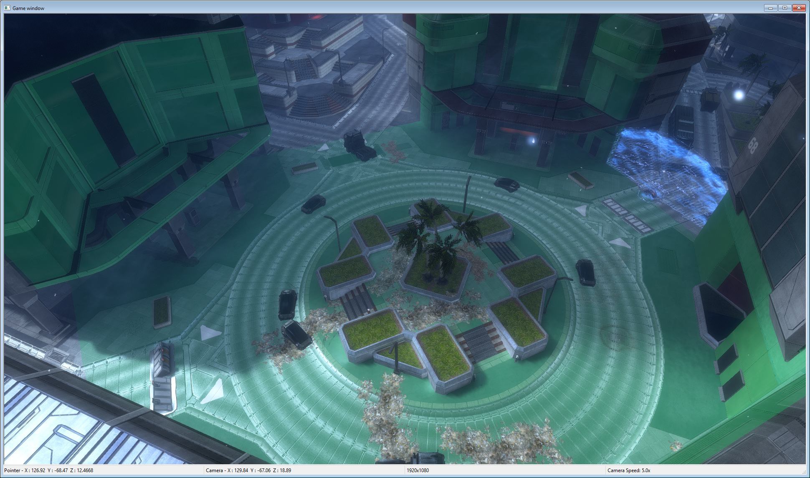

# H3ODSTEK Cluster Points Fix
Fixes the issue in the Halo 3: ODST Mod Tools where the clusters would not light up in different colours when "Cluster Points" is selected in Sapien

All the fix does is remove the DX9 check for the `debug_tint` parameter and where it applies the tint, since MCC and the H3ODSTEK run on DX11.

# Install Instructions

1. Download the repository and drop the `source` and `tags` folders into your H3ODSTEK folder (Back up and compare the files to yours if you edited your own HLSL files)
2. Open a command prompt in the H3ODSTEK folder
3. Run `tool dump-render-method-options` and wait for the command to finish[^1]
4. Once finished, run `tool generate-templates win shaders\shader` and after that `tool generate-templates win shaders\terrain` (You can do the others as well, these are just the most important)
5. Done! You should now be able to see the cluster points in colour just like the previous games.

[^1]: A full guide and other information on shader compiling can be found here: https://c20.reclaimers.net/h3/guides/shaders/compiling-shaders/
